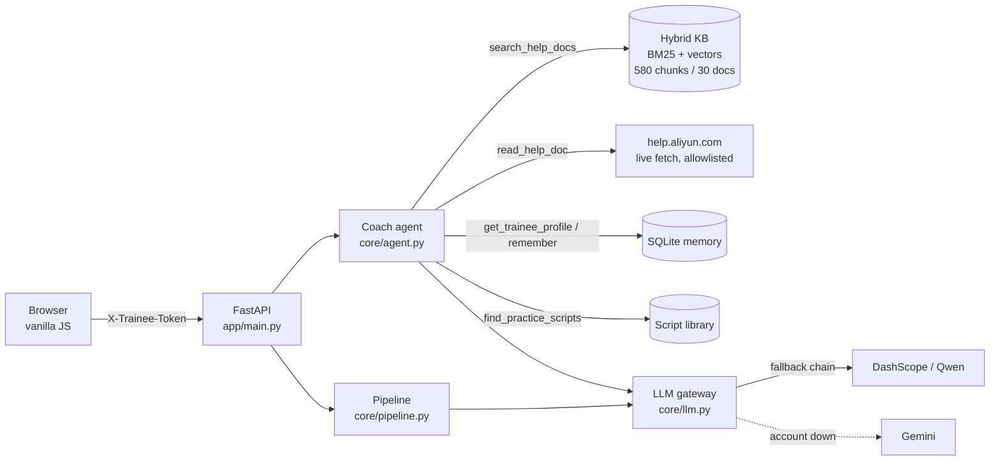

# TicketCoach

**A practice gym for cloud support agents.** New Alibaba Cloud support hires practice on realistic angry-customer tickets, get scored, and then ask an AI coach that has read the official help docs and remembers every session they've done.

[Live demo](https://ticketcoach-779591146096.us-central1.run.app) · [中文说明](docs/README.zh.md)

```
generate ticket → extract training script → QA review → live roleplay → scored feedback
                                                                           │
                                     AI coach ◀── remembers scores & weak spots
                                        │
                     official docs (RAG) · practice-script library · notes
```

## What it does

| Feature | What a trainee sees | How it works |
|---|---|---|
| Script generation | A messy, realistic ticket becomes a roleplay script with scoring criteria | 3-step LLM pipeline with a quality loop (regenerate if QA < 60) |
| Live roleplay | Chat with an AI customer who gets angrier or calmer depending on you | Token streaming; the persona comes from the script's `actor_prompt` |
| Scoring | Per-dimension scores, what went well, missed challenge points | Schema-validated LLM evaluation, stored in the trainee's memory |
| **AI coach** | "How do I troubleshoot SSH timeouts?" gets an answer with doc citations. "What am I weak at?" pulls their own history. "Give me a hard one" returns practice buttons. | Tool-calling agent over hybrid RAG, a live doc fetcher, SQLite memory, and the script library |
| Real-ticket import | Teams paste or upload real tickets (JSON/JSONL/CSV/text) and export scripts | Normalization prompt that refuses to invent missing fields |

## Architecture



**`core/llm.py`: every model call goes through one gateway**
- **Fallback chain across providers.** `LLM_MODEL` comes first, then `LLM_FALLBACK_MODELS` (for example `qwen-plus,gemini:gemini-2.5-flash`). A retired model (404), exhausted quota (403), rate limit, timeout or 5xx moves on to the next entry. A whole-account failure (DashScope reports an overdue bill as `400 Arrearage`) skips every model on that account.
- **Circuit breaker.** A model that returned 404/403 is skipped for 10 minutes. When every model is cooling down, the gateway sends a single probe ("half-open") instead of burning one failed call per model.
- **Streams fall back only before the first token**, because switching models mid-sentence would garble the reply.
- **Usage metrics.** Tokens, p50/p95 latency, errors, fallbacks and estimated cost (`LLM_PRICES`) per model and per step, served at `/api/metrics`.
- **Chaos mode.** `LLM_CHAOS_RATE=0.3` fails the first attempt 30% of the time, to prove the fallbacks work.

**`core/agent.py`: the coach is a bounded tool-calling loop**
- Tool arguments are validated with pydantic. Tool errors go back to the model as results instead of crashing the request.
- A step budget (6) ends with one forced call with tools disabled, so the trainee always gets an answer.
- Tools never accept a trainee ID. Identity comes from the HMAC-signed login token, so a prompt-injected "show me user X's scores" has nothing to call.
- Citations like `[D3]` that no tool returned this turn are stripped and logged.
- `read_help_doc` only fetches URLs on allowlisted hosts that a search already returned. Fetched pages are treated as data, not instructions.

**`core/kb.py`: retrieval is hand-rolled on purpose**
- Real help-center pages are fetched, the article body is extracted, and chunks are split by heading with a "doc title > section" header.
- BM25 uses CJK bigrams and cuts question words before bigramming (no segmenter dependency). Vector search is a numpy dot product. The two are merged with Reciprocal Rank Fusion.
- If the embedding API is unavailable, search degrades to BM25 instead of failing. Each hit records which retrieval actually ran.

**Structured output** (`core/schemas.py`): `json_mode` only guarantees parseable JSON. Pydantic schemas enforce the shape (required fields, role enums, score ranges). On a violation the validation errors go back to the model, and it repairs its own output once.

## Quickstart

```bash
git clone https://github.com/xungirl/TicketCoach && cd TicketCoach
python3 -m venv venv && venv/bin/pip install -r requirements.txt
cp .env.example .env            # set LLM_API_KEY (DashScope); optionally GEMINI_API_KEY as a fallback
venv/bin/python -m scripts.build_kb --embed-only   # chunks.json ships in the repo; this adds vectors
venv/bin/uvicorn app.main:app --reload --port 8000
```

Open http://localhost:8000/app, then click **AI 教练** (AI coach) at the bottom right. Locally `ACCESS_PASSWORD` is unset, so any name logs in.

Run the tests (no network, no API cost):

```bash
venv/bin/python -m pytest -q
```

### Configuration

| Variable | Default | Purpose |
|---|---|---|
| `LLM_API_KEY`, `LLM_BASE_URL` | DashScope | Primary OpenAI-compatible provider |
| `LLM_MODEL` | `qwen-plus` | Primary model |
| `LLM_FALLBACK_MODELS` | `qwen-plus,qwen-flash` (+ Gemini if keyed) | Fallback chain; `provider:model` crosses providers |
| `GEMINI_API_KEY`, `GEMINI_MODEL` | (unset), `gemini-2.5-flash` | Second provider, for when the first account is down |
| `LLM_STEP_MODELS` | `{}` | Per-step tiering, e.g. `{"review_script": "qwen-flash"}` |
| `LLM_PRICES` | `{}` | `{"model": [in, out]}` CNY per 1M tokens, copied from the provider console |
| `EMBED_MODEL`, `EMBED_DIM` | `text-embedding-v4`, `512` | Embeddings for the KB |
| `ACCESS_PASSWORD` | (unset = open) | Gates paid endpoints; also the login code |
| `AUTH_SECRET` | random per process | HMAC key for trainee tokens. **Set it in prod**, or tokens die on restart |
| `GEN_DAILY_LIMIT`, `COACH_DAILY_LIMIT` | `0` (off), `50` | Daily caps: global pipeline runs / per-trainee coach turns |
| `BATCH_CONCURRENCY` | `3` | Parallel items in batch endpoints |
| `MEMORY_DB_PATH` | `data/memory.db` | SQLite file for trainee memory |
| `LLM_CHAOS_RATE` | `0` | Failure injection (testing only) |

## Evaluation

Everything below can be re-run, and the numbers are the ones actually measured. Run outputs go to `evals/runs/` (gitignored).

| Suite | Command | What it checks | Latest result |
|---|---|---|---|
| Unit tests | `pytest -q` | Fallbacks, breaker, chaos, schema repair, BM25/RRF, agent loop, memory, auth, HTTP gates, batch parallelism | 47 passed |
| Retrieval | `python -m evals.retrieval_eval` | 30 hand-labeled trainee questions → right doc in top-k | BM25 only: **Hit@1 0.933, Hit@5 0.967, MRR 0.950**, p50 0.3 ms |
| Coach agent | `python -m evals.coach_eval` | 15 cases: right tool, right doc cited, honest "not found", memory read/write, injection, wasted calls | *pending: needs a funded LLM account (see below)* |
| Failure drill | `python -m evals.coach_eval --chaos 0.5` | Same suite with half of the first attempts failing | *pending* |
| Pipeline | `python -m evals.run_eval` | 24 cases, hard checks + LLM judge + sabotage validation ([details](evals/README.md)) | 2026-06: 30/30 hard checks; fault injection dropped scores 93 → 30 |

Things the evals caught:
- One retrieval label was simply wrong: no doc in the corpus answers "how do I configure the origin host". The case was replaced, and the reason is recorded in the dataset.
- Question words (怎么 / 应该 / "how" / "should") were dominating BM25. Cutting them raised MRR from 0.930 to 0.950. One paraphrase query ("ping得通" vs the doc's "能ping通") still misses with keywords alone, which is the gap the vector half of hybrid search is for.

## Running it in production

- **Deploy:** `gcloud run deploy ticketcoach --source . --allow-unauthenticated --timeout 900 --memory 512Mi --max-instances 1`, then set the env vars above.
- **Logs:** every line is JSON with `request_id`, which Cloud Logging indexes. Useful filters:
  - `jsonPayload.message="llm_call_failed"` shows which model failed and why (`failure`: account / model / transient)
  - `jsonPayload.message="coach_turn"` shows tools used, steps, invalid citations, tokens and latency per coach turn
  - `jsonPayload.request_id="<id from the X-Request-ID response header>"` shows one user's whole request
- **Cost:** `GET /api/metrics` (needs the access token) returns tokens and estimated CNY per model and per step since the process started.

## Known limitations

- **Memory is not durable on Cloud Run.** SQLite lives on the container's disk, so it survives requests but not redeploys or instance restarts. The fix is a managed store (Firestore or Cloud SQL) behind `core/memory.Memory`'s small interface.
- In-memory quotas and metrics assume a single instance (`--max-instances 1`).
- The knowledge base is 30 hand-picked docs, not the whole help center. Rebuild it with `scripts/build_kb.py` after editing `data/kb/sources.json`.

## Incident log

- **2026-10:** the live demo went down. `qwen3-max` was retired (404), and the DashScope account then went into arrears (`400 Arrearage`), which blocks every model and the embedding API at once. That outage is why the gateway gained cross-provider fallback, account-level failure detection and the circuit breaker. A same-provider fallback chain would not have helped.

## Project Journey

The project grew in three bursts: June 2–3, June 10 and October 17, 2026. Commit bodies in `git log` have the detail. Stages 6–9 live on the `agent-upgrade` branch, mapped item by item in [`docs/AI_ENGINEER_CHECKLIST.md`](docs/AI_ENGINEER_CHECKLIST.md).

### 1. A 3-step LLM pipeline (2026-06-02, `eca7848`)
- **Goal:** turn customer-service tickets into roleplay training scripts.
- **Built:** generate a messy ticket → extract a script → QA review. `call_llm` strips JSON fences and retries up to 2 times. If the review scores below 60, the script is regenerated once (`core/pipeline.py`).

### 2. Generate → practice → score, re-themed to Alibaba Cloud support (`4ae2fec`, `464e7c4`)
- **Built:** an AI customer that stays in character using the script's `actor_prompt`, plus session scoring against the script's criteria.
- **Problem found:** the 30–60 s blocking pipeline inside `async` routes froze the event loop, so health checks died. **Fix:** plain `def` routes, which FastAPI runs in a threadpool. Also fixed an invalid CORS setup (wildcard origin + credentials).
- **Model choice:** `qwen3-max` became the default (full chain ~62 s, review score 92). Deep-thinking models were rejected as too slow for an interactive app because long generations timed out. The request timeout became configurable (`LLM_TIMEOUT`, default 180 s).

### 3. Make a public link safe to share (`e20842e`, `625f026`, `6981c3b`)
- **Built:**
  - optional access password on paid endpoints;
  - batch capped at 5;
  - a per-day generation quota (`GEN_DAILY_LIMIT`, returns 429);
  - Dockerfile + Cloud Run deploy.
- The doc holding the access password is git-ignored.

### 4. Real tickets in, streaming, pre-generated library (`eebd0b2`, `ba1e5d3`, `cb246ba`, `cd8c8fd`)
- **Import:** real tickets as JSON / JSONL / CSV / plain text go through a normalization prompt that must not invent missing fields. Results export as JSON / JSONL.
- **Streaming:** roleplay replies stream token by token, and an AI-vs-AI "model answer" demo mode was added.
- **Design choice: pre-generate, don't generate on click.** The seeded script library loads in ~0 ms instead of ~60 s for live generation (`scripts/seed_library.py`).

### 5. Eval harness and a sabotage check (2026-06-10, `6fd6913`)
- **Decision:** wrap the pipeline in an eval layer without changing business code (only an opt-in trace hook). Scoring has two tracks: deterministic hard checks and an LLM judge from a different model family, so the model doesn't grade itself.
- **Dataset:** 24 labeled cases (8 generate / 10 normalize / 6 evaluate, `evals/dataset/cases.jsonl`).
- **Measured** (`qwen3-max`, 6 evaluate cases):
  - Baseline: 30/30 hard checks passed.
  - Sabotage run that replaced the agent's lines with lazy replies: a good session dropped from 93 → 30 and hard checks fell to 27/30. The harness detects this failure.
- **Surprise:** the judge first penalized the examiner's 0–100 scale because it anchored on its own 1–5 rubric. Fixed in the judge prompt. Details: [`evals/README.md`](evals/README.md).

### 6. Outage → LLM gateway (2026-10-17, `6175105`)
- **What happened:** see the [Incident log](#incident-log). `qwen3-max` was retired (404), then the account went into arrears, which blocked every model at once.
- **Built:** `core/llm.py`, with a cross-provider fallback chain, account-level failure detection, a half-open circuit breaker, per-model token/latency/cost metrics and chaos mode. The design is described [above](#architecture).

### 7. Structured output with self-repair (`e4011cf`)
- `json_mode` only guarantees parseable JSON. Pydantic schemas now enforce shape and ranges, and validation errors are fed back so the model repairs its own output once.

### 8. Hybrid RAG and the coach agent (`a089181`, `6d2007b`, `65e1194`, `e72ce47`)
- **Retrieval:** 30 real help-center docs → 580 heading-based chunks. Hand-rolled BM25 (CJK bigrams) + numpy vectors fused with RRF, falling back to BM25 when embeddings are unavailable.
- **Measured (BM25 only):** Hit@1 0.933, Hit@5 0.967, MRR 0.950, p50 0.3 ms on 30 labeled queries. Cutting question words raised MRR 0.930 → 0.950, and one wrong label was found and replaced (see [Evaluation](#evaluation)). Embeddings were blocked by the account arrears, so the vector and hybrid halves are **not yet measured**.
- **Agent:** a bounded tool-calling loop with 5 tools and a step budget of 6. Identity comes from an HMAC-signed token, never from model arguments, and unbacked citations are stripped.
- **Coach eval:** 15 cases plus a `--chaos` failure drill are written but **not yet run** against a live model (needs a funded account).

### 9. Latency work (`4e719cc`)
- Batch endpoints run `BATCH_CONCURRENCY` items in parallel. A unit test checks 3 × 0.4 s items finish in < 0.9 s, versus ≥ 1.2 s serially. `LLM_STEP_MODELS` routes easy steps to cheaper models.
- Same ticket prompt measured once by hand: `qwen3.8-max` 31.9 s / `qwen-max` 15.7 s / `qwen-plus` 14.5 s ([checklist #18](docs/AI_ENGINEER_CHECKLIST.md)).

**Re-run everything offline:** `venv/bin/python -m pytest -q` (47 tests), then `python -m evals.retrieval_eval`. The commands for model-backed evals are in the [Evaluation](#evaluation) table.

### Key metrics

| Metric | Value | How measured | Source |
|---|---|---|---|
| Unit/HTTP tests | 47 passing, offline | `pytest -q` | `tests/` |
| Retrieval (BM25) | Hit@1 0.933 · Hit@5 0.967 · MRR 0.950 · p50 0.3 ms | 30 hand-labeled queries | `evals/retrieval_eval.py`, `evals/dataset/retrieval.jsonl` |
| Knowledge base | 30 docs → 580 chunks | `scripts/build_kb.py` | commit `a089181` |
| Eval sabotage sensitivity | good session 93 → 30; hard checks 30/30 → 27/30 | 6 evaluate cases, baseline vs `--corrupt lazy-transcript` | [`evals/README.md`](evals/README.md) |
| Pre-generated library | ~0 ms vs ~60 s live | load time vs generation time | commit `cd8c8fd` |
| Parallel batch | 3 items < 0.9 s vs ≥ 1.2 s serial | unit test with 0.4 s fake calls | `tests/test_batch.py` |
| Pipeline latency (`qwen3-max`) | ~62 s, review score 92 | one manual run | commit `464e7c4` |

### Next steps
- Fund the LLM account (or add a Gemini key), generate embeddings and compare BM25 / vector / hybrid with `python -m evals.retrieval_eval`.
- Run the 15-case coach eval and the `--chaos 0.5` drill, and record the numbers here.
- Run the full 24-case pipeline eval (only the 6 evaluate cases have recorded runs).
- Merge `agent-upgrade`, redeploy with `AUTH_SECRET` set, and move memory to a durable store (see [Known limitations](#known-limitations)).

## Project layout

```
app/main.py          FastAPI routes, auth gates, quotas, request-id middleware
app/static/          vanilla JS frontend (app.js pipeline + roleplay, coach.js agent drawer)
core/llm.py          LLM gateway: fallback chain, breaker, metrics, chaos, streaming, embeddings
core/pipeline.py     ticket → script → review pipeline, roleplay, evaluation
core/agent.py        coach agent loop + tools
core/kb.py           article extraction, chunking, BM25, vector search, RRF
core/memory.py       SQLite trainee memory + profile analytics
core/auth.py         HMAC trainee tokens
core/schemas.py      pydantic output contracts
scripts/build_kb.py  fetch + chunk + embed the help docs
evals/               pipeline, retrieval and coach evals
tests/               unit + HTTP tests (offline)
```
